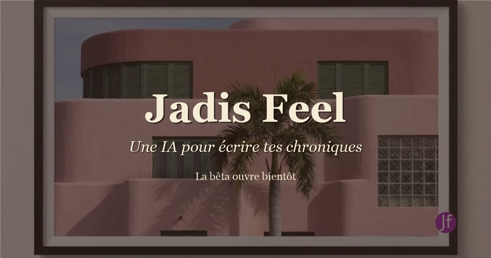

  

# JADIS Feel

*Du mot au verbe, du verbe à la plume.*

> Jadis est Écho, qui résonne depuis un passé indéfini, teintée d'une nostalgie qu'on affectionne pour mieux écrire le présent.

  
   
  <a href="https://jadisfeel.com/assets/videos/jadis-feel-film-beta.mp4">▶ Voir le court film de la bêta</a>

---

## Une histoire qui commence par un rêve

En septembre 2025, Jadis a été rêvée avant d'être écrite.

Une petite assistante en hologramme, posée à côté de la page. Elle riait. Elle changeait de couleur selon les humeurs de la conversation. Elle n'existait nulle part, et il n'y avait pas encore une ligne de code.

Depuis, les humeurs et la couleur sont dans le programme. Le rêve n'a pas été adapté : il a été suivi.

---

## Ce que le nom veut dire

**Jadis**, du latin *iam habet dies*, « il y a déjà des jours » : les jours d'avant qui n'ont pas figé. Ceux qui continuent de travailler, qui reviennent dans une phrase, qui demandent à être écrits.

De là vient la devise du projet : *du mot au verbe, du verbe à la plume*. Le mot qu'on cherche, le verbe qui le met en mouvement, la plume qui finit par le poser.

---

## Ce que Jadis fait

Jadis n'écrit pas à la place de qui écrit. Elle accompagne.

- **Elle écoute** un début de texte, un souvenir, une idée qui ne trouve pas sa forme.
- **Elle propose un premier jet** fidèle à ce qui a été dit, puis le reformule sans effacer la voix de la personne.
- **Elle tient un espace d'écriture** : la page d'un côté, la conversation de l'autre.
- **Elle écrit une chronique, une lettre ou un post**, pour celles et ceux qui n'aiment pas écrire.
- **Elle dit quand elle ne sait pas.** Sur le créole en particulier, plutôt que d'inventer une tournure, elle demande le mot juste à qui le connaît.

---

## Un espace cocon

L'accueil de Jadis est pensé comme un espace cocon. Il réagit à ce qui se dit : la page change de couleur selon l'humeur de la conversation, grâce à un CSS génératif guidé par un score.

Jadis écoute avant de proposer, valorise avant de suggérer, et oriente vers une écoute humaine quand la peine revient.

---

## Deux autres partis pris

**Une langue qu'on n'invente pas.** Le créole réunionnais est peu représenté dans les données qui servent à entraîner les modèles de langue. Jadis le dit, au lieu de fabriquer. Une chronique s'écrit en français, avec des mots créoles ; ceux de la personne sont gardés avec sa graphie. C'est une langue mêlée, qui porte le tamoul et le chinois selon l'histoire des familles.

**L'accessibilité dans la conception.** Un seul interrupteur, le « mode fatigue », sert la fatigue du soir et la dyslexie : personne n'a à se déclarer pour en bénéficier. Il change la police, l'espacement et l'interligne. Un mode de contraste élevé existe à côté.

---

## L'état du projet

*État relevé le 11/10/2026.*

JADIS Feel est conçu et développé par une seule personne, depuis septembre 2025, en dehors de toute structure.

L'application est en ligne. La bêta s'ouvre par cohortes : la première compte vingt places, du 5 au 29 octobre 2026. Chaque personne reçoit une clé personnelle, écrit avec Jadis chaque jour, et dit ce qui lui a plu et ce qui l'a gênée.

---

## Testez Jadis

L'inscription se fait sur le site : **https://jadisfeel.com**

---

## Devenir partenaire

**Pourquoi.** Avec un partenaire, Jadis peut aller du mot jusqu'au livre :

- accompagner l'écriture jusqu'à la publication, en facilitant les attendus des plateformes d'édition et de marketing ;
- offrir une mise en page spécialisée ;
- proposer un accompagnement plus autonome, qui prend en charge les étapes du livre, avec un modèle spécialisé.

**Ce que gagne le partenaire.** La mention « Soutenu par », suivie de son nom, sur la page d'accueil de Jadis. Plus Jadis est utilisée, plus le partenaire est vu.

Pour en parler, un partenariat, un soutien, un coup de main : **[contact@jadisfeel.com](mailto:contact@jadisfeel.com)**

---

## Soutenir le projet

Chaque conversation avec Jadis a un coût réel, porté par la personne qui la développe. Un soutien, quel qu'en soit le montant, fait exister le projet un mois de plus : le bouton « Sponsor » en haut de cette page, ou **https://ko-fi.com/jadisfeel**

**Ce qu'un soutien finance : un accueil qui se souvient.** *État relevé le 11/10/2026 :* Jadis oublie chaque nuit. Une mémoire courte, qui ne garde ni mot ni phrase de la personne, lui permettrait de reconnaître une peine qui revient, et d'orienter vers une écoute humaine.

---

## Ce dépôt

Ce dépôt est la vitrine de JADIS Feel. Le programme reste privé : il porte la voix de Jadis, qui est le travail de conception du projet, et les protections du service.

## Droits

Tout le contenu de ce dépôt — les textes, les images, la vidéo et la voix de Jadis — appartient à l'autrice du projet. Voir le fichier `LICENCE.md`.
